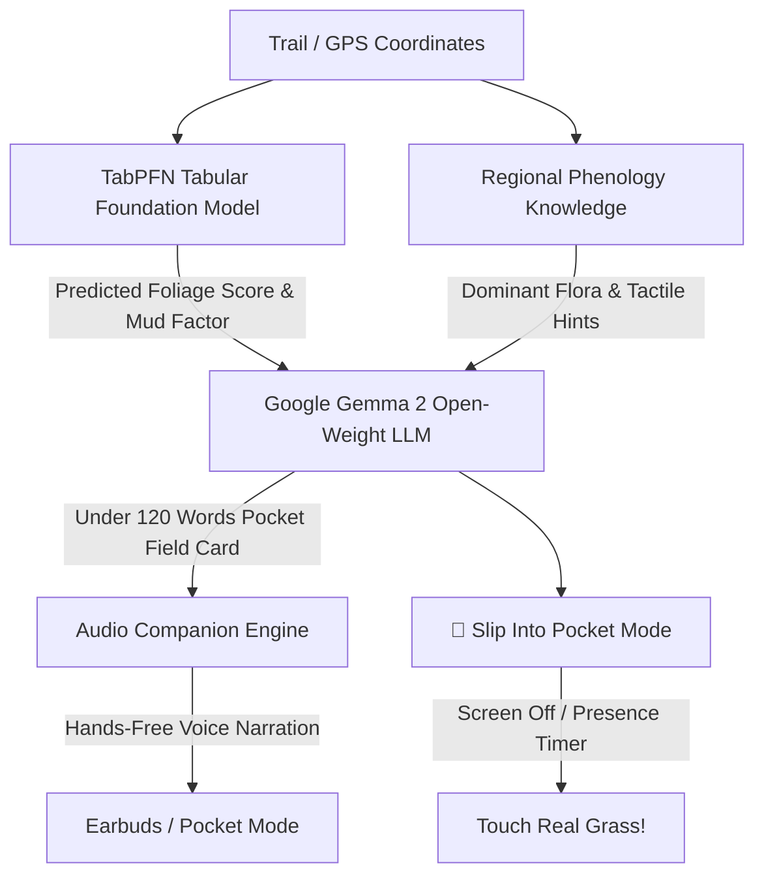

# 🍁 VerdantPulse — Zero-Screen Trail & Foliage Companion

> *"Touch Grass. Put your screen away in 60 seconds. Powered by Open-Source AI (Google Gemma 2 + Prior Labs TabPFN)."*

Built for the **[Hacktoberfest Open-Source AI Challenge Week 1: Touch Grass](https://dev.to/challenges/hacktoberfest-week1-2026-10-05)**.

🌐 **Live Production URL:** **[https://verdant-pulse.vercel.app](https://verdant-pulse.vercel.app)**

---

## 🌲 What is VerdantPulse?

Modern outdoor apps (AllTrails, Google Maps, plant identification apps) suffer from a fundamental paradox: **they keep you staring at a glowing glass screen while standing in the middle of a majestic forest.** Even worse, the moment you hike into a mountain canyon or dense canopy, cell signal drops to zero, and cloud AI APIs immediately crash.

**VerdantPulse** is an open-source AI field companion designed with an inversion principle: **The screen must be the shortest part of the experience (< 60 seconds).**

1. **TabPFN Tabular Engine**: Predicts today's **Fall Foliage Color Progression Index (0-100%)** and **Trail Mud/Footing Factor** from microclimate tabular features (Day of Year, elevation lapse rate, rainfall, temperature).
2. **Gemma 2 Open-Weight Intelligence**: Google's `gemma-2-2b-it` synthesizes the tabular forecast into a concise **"Pocket Field Card"** with 3 concrete tactile challenges:
   - 🌿 **Touch**: A real physical texture (crushed sugar maple leaves, peeling paper birch bark, damp humus).
   - 🍂 **Sight**: A canopy gradient to spot at a specific elevation.
   - 💨 **Scent/Acoustic**: An earthy forest aroma or bird call to identify with closed eyes.
3. **Hands-Free Audio Companion**: Narrates the field card via voice (ElevenLabs or offline Web Speech) with procedural Web Audio forest soundscapes.
4. **📴 "Slip Into Pocket" Mode**: Triggers a haptic pulse, shifts into an ultra-low-power AMOLED dark display, and counts your off-screen minutes in the wild.

---

## 🛠️ Architecture



---

## 🚀 Why Open Innovation Matters

- **Zero-Signal Survival**: National parks and backcountry ridges have no cell signal. Gemma 2 runs entirely offline on a laptop, edge device, or local client.
- **Location Sovereignty**: No proprietary ad tech or cloud servers ever receive your GPS coordinates or trail routines.
- **Zero API Invoices**: 100% free to run indefinitely with zero subscription barriers.

---

## 💻 Quick Start

### Option 1: Standalone Web App (No setup required)
Simply open `index.html` in any modern web browser:
```bash
# Windows
start index.html

# Mac / Linux
open index.html
```

### Option 2: Run with Local Gemma 2 via Ollama
1. Install [Ollama](https://ollama.com/)
2. Pull Gemma 2:
```bash
ollama run gemma2:2b
```
3. Open VerdantPulse, click `⚙️ Config`, and ensure the endpoint points to `http://localhost:11434/api/generate`.

### Option 3: Python FastAPI Edge Backend
```bash
pip install fastapi uvicorn numpy pydantic tabpfn transformers torch
python server.py
```

---

## 🏆 Hacktoberfest Prize Categories Targeted

- **Best Use of Gemma ($200)**: Local edge inference with `google/gemma-2-2b-it` for zero-cloud field card synthesis.
- **Best Use of TabPFN ($200)**: In-context tabular foundation regression on historical phenology tables.
- **Best Use of ElevenLabs ($100)**: Audio companion narration to keep eyes off screens and ears tuned to nature.
